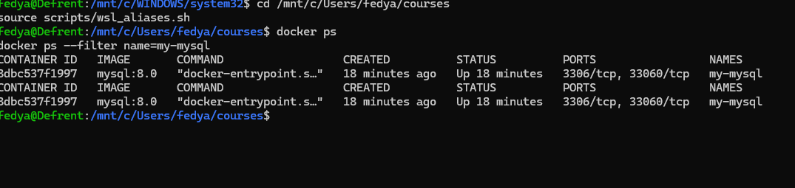
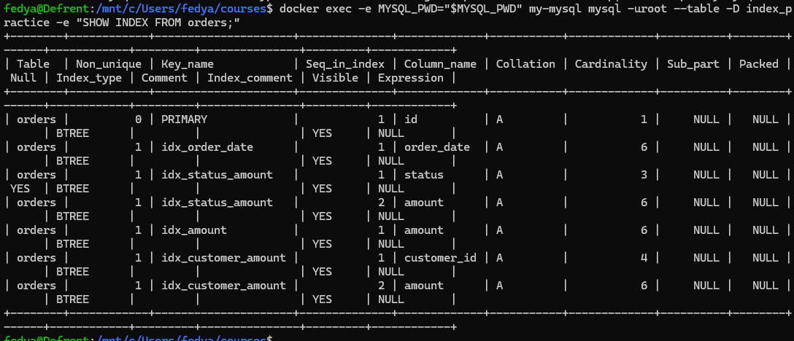
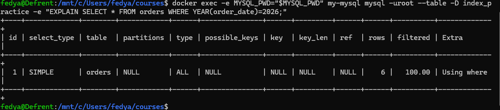
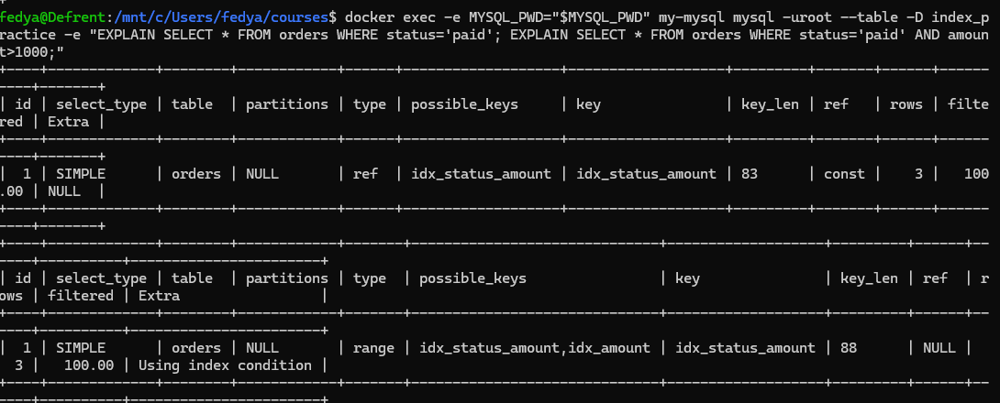
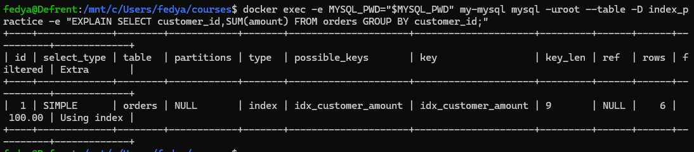

# Лабораторная работа: индексы в MySQL

Практическая работа выполнена строго в WSL через Docker Desktop. База данных называется `index_practice`, а журнал записывается в контейнерный файл `/var/lib/mysql/general.log`.

## Результат подготовки

- Контейнер: `my-mysql`
- Образ: `mysql:8.0`
- База: `index_practice`
- Таблицы: `customers`, `orders`
- Исходных строк: 5 клиентов и 6 заказов
- Созданные индексы: `idx_amount`, `idx_order_date`, `idx_status_amount`, `idx_customer_amount`

## Файлы проекта

| Файл | Назначение |
|---|---|
| `my.cnf` | Настройка UTF-8 и general log |
| `sql/01_setup.sql` | Создание базы и исходных таблиц |
| `sql/02_explain_before.sql` | Исходный `EXPLAIN` без индекса по `amount` |
| `sql/03_explain_after_amount.sql` | Индекс `idx_amount` |
| `sql/04_function_index.sql` | Пример с функцией и переписанный диапазон |
| `sql/05_composite_index.sql` | Составной индекс |
| `sql/06_covering_index.sql` | Покрывающий индекс |
| `sql/07_explain_analyze.sql` | Реальный план выполнения |
| `scripts/run_sql.py` | Безопасный запуск SQL-файлов из Windows shell |
| `scripts/run_lab_wsl.sh` | Пересоздание контейнера и volume в WSL |
| `scripts/wsl_aliases.sh` | Docker-обёртка и переменная пароля внутри WSL |
| `scripts/check_docker.sh` | Проверка контейнера и первого EXPLAIN |
| `scripts/export_lab.sh` | Экспорт дампов и general log |
| `scripts/filter_general_log.py` | Фильтрация журнала до SQL-действий пользователя |
| `general.log` | Полный journal из контейнера |
| `my_actions.log` | Отфильтрованный журнал действий |
| `index_dump.sql` | Обычный дамп базы |
| `index_dump_clean.sql` | Чистый дамп с версиями GTID и транзакции |

## 1. Запуск в WSL

Перейдите в папку проекта:

```bash
cd /mnt/c/Users/fedya/courses
```

Проверьте Docker CLI внутри WSL:

```bash
/mnt/c/Users/fedya/AppData/Local/Programs/DockerDesktop/resources/bin/docker.exe ps
```

Запустите подготовку контейнера:

```bash
bash scripts/run_lab_wsl.sh
```

Скрипт удаляет только контейнер `my-mysql` и volume `mysql_data`, создаёт контейнер заново и загружает исходные данные.

## 2. Проверка журнала

Убедитесь, что general log включён:

```bash
docker exec my-mysql mysql -uroot -p123 \
  -e "SHOW VARIABLES LIKE 'general_log'; SHOW VARIABLES LIKE 'log_output';"
```

В начале работы лог очищается:

```bash
docker exec -u mysql my-mysql sh -c ': > /var/lib/mysql/general.log'
```

## 3. Запуск SQL-экспериментов

Если запуск выполняется из WSL, загрузите локальную обёртку Docker:

```bash
source scripts/wsl_aliases.sh
docker ps
```

Эта команда направляет `docker` в Docker Desktop CLI Windows и задаёт локальную переменную `MYSQL_PWD`.

Из корня репозитория выполните все файлы в нужном порядке:

```bash
python scripts/run_sql.py \
  sql/01_setup.sql \
  sql/02_explain_before.sql \
  sql/03_explain_after_amount.sql \
  sql/04_function_index.sql \
  sql/05_composite_index.sql \
  sql/06_covering_index.sql \
  sql/07_explain_analyze.sql
```

При повторном запуске база сбрасывается в [sql/01_setup.sql](sql/01_setup.sql), поэтому предыдущие индексы не мешают эксперименту.

## 4. `EXPLAIN` до индекса

```sql
SHOW INDEX FROM orders;
EXPLAIN SELECT * FROM orders WHERE amount > 1000;
```

Фактический план без индекса по `amount`:

| table | type | possible_keys | key | rows | Extra |
|---|---|---|---|---:|---|
| orders | `ALL` | NULL | NULL | 6 | Using where |

Вывод: MySQL выполняет полный просмотр таблицы.

## 5. Индекс по `amount`

```sql
CREATE INDEX idx_amount ON orders(amount);
SHOW INDEX FROM orders;
EXPLAIN SELECT * FROM orders WHERE amount > 1000;
```

Фактический план после создания индекса:

| table | type | possible_keys | key | rows | Extra |
|---|---|---|---|---:|---|
| orders | `range` | idx_amount | `idx_amount` | 4 | Using index condition |

Индекс использован для диапазонного поиска.

## 6. Функция в `WHERE`

Запрос с функцией не использует индекс по `order_date`:

```sql
EXPLAIN SELECT * FROM orders
WHERE YEAR(order_date) = 2026;
```

Результат: `type = ALL`, `key = NULL`, `rows = 6`.

Создайте индекс и перепишите условие без функции:

```sql
CREATE INDEX idx_order_date ON orders(order_date);

EXPLAIN SELECT * FROM orders
WHERE order_date >= '2026-01-01'
  AND order_date < '2027-01-01';
```

Результат переписанного запроса: `type = range`, `key = idx_order_date`, `rows = 6`.

Правило: функция над индексируемым столбцом в `WHERE` может отключать использование индекса.

## 7. Составной индекс

```sql
CREATE INDEX idx_status_amount
  ON orders(status, amount);

EXPLAIN SELECT * FROM orders
WHERE status = 'paid';

EXPLAIN SELECT * FROM orders
WHERE status = 'paid' AND amount > 1000;
```

Фактические планы:

| Запрос | type | key | rows |
|---|---|---|---:|
| `status = 'paid'` | `ref` | `idx_status_amount` | 3 |
| `status = 'paid' AND amount > 1000` | `range` | `idx_status_amount` | 3 |

Затем временно удалите индекс по `amount`, чтобы проверить левый префикс отдельно:

```sql
DROP INDEX idx_amount ON orders;
EXPLAIN SELECT * FROM orders
WHERE amount > 1000;
CREATE INDEX idx_amount ON orders(amount);
```

Для запроса только по `amount` план стал `ALL`, а составной индекс `(status, amount)` не использовался.

## 8. Покрывающий индекс

```sql
CREATE INDEX idx_customer_amount
  ON orders(customer_id, amount);

EXPLAIN SELECT customer_id, SUM(amount)
FROM orders
GROUP BY customer_id;
```

Фактический план:

| type | key | rows | Extra |
|---|---|---:|---|
| `index` | `idx_customer_amount` | 6 | `Using index` |

`Using index` означает покрывающий индекс: запрос получил нужные значения непосредственно из индекса.

## 9. `EXPLAIN ANALYZE`

```sql
EXPLAIN ANALYZE
SELECT * FROM orders
WHERE amount > 1000;
```

На выполненной базе запрос дал диапазонный поиск по `idx_amount`:

```text
Index range scan on orders using idx_amount
actual time=0.104..0.108 rows=4 loops=1
```

## 10. Экспорт дампов и лога

Остановите журналирование, скопируйте полный log и создайте два дампа:

```bash
bash scripts/export_lab.sh
```

Скрипт выполняет:

```bash
docker exec my-mysql mysql -uroot -p123 \
  -e "SET GLOBAL general_log='OFF';"
docker cp my-mysql:/var/lib/mysql/general.log ./general.log
docker exec -e MYSQL_PWD=123 my-mysql \
  mysqldump -uroot index_practice > index_dump.sql
docker exec -e MYSQL_PWD=123 my-mysql \
  mysqldump -uroot --set-gtid-purged=OFF \
  --single-transaction --databases index_practice \
  > index_dump_clean.sql
python scripts/filter_general_log.py general.log my_actions.log
```

Отфильтрованный журнал содержит только осмысленные SQL-команды и многострочные продолжения. Технические подключения и запросы `@@version_comment` исключаются.

Проверка журналирования после выполнения:

```bash
tail -n 30 my_actions.log
```

## 11. Итоговая шпаргалка

| План/значение | Значение |
|---|---|
| `ALL` | Full scan |
| `range` / `ref` | Поиск с использованием индекса |
| `Using index` | Покрывающий индекс |
| Функция в `WHERE` | Часто отключает индекс |
| `(A, B)` | Работает для `A` и `(A, B)`, но не для `B` |
| `EXPLAIN ANALYZE` | Реальное время и число обработанных строк |

В дампе сохраняются таблицы, данные и экспериментальные индексы.

## Скриншотты









